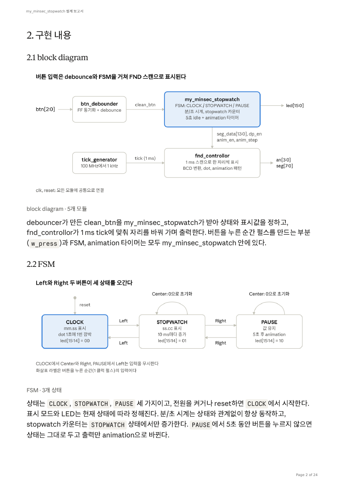
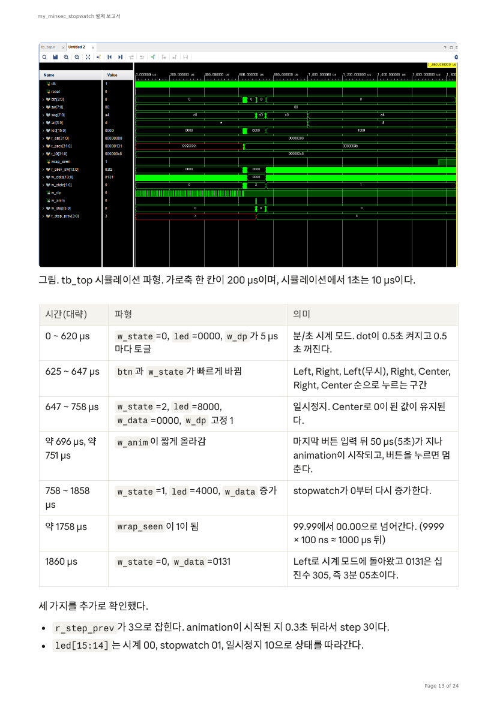

# ⏱️ FPGA 분/초 시계 + 10ms Stopwatch (Basys3, Verilog)

> **Basys3(Artix-7 xc7a35t)** 보드에서 **분/초 시계**와 **10ms 단위 stopwatch**를 하나의 FSM으로 전환하고, 일시정지 중에는 4자리 FND에 **circle animation**을 표시하는 Verilog 설계입니다.
> *AI 시스템반도체 SW개발자 2기 (대한상공회의소) · FPGA 과정 · Vivado 2020.2 · 100MHz*

## ✨ 동작 요약

| 모드 | FND | LED[15:14] | 버튼 |
|---|---|---|---|
| CLOCK (분/초 시계) | `mm.ss` (사이 dot 1초 깜박임) | 00 | Left → stopwatch |
| STOPWATCH | `ss.cc` (cc = 10ms) | 01 | Left: 시계 복귀 · Right: 일시정지 · Center: 0 초기화 |
| PAUSE | 멈춘 `ss.cc` | 10 | Right: 재개 · Center: 0 초기화 |

- **circle animation**: PAUSE에서 5초간 입력이 없으면 세그먼트 한 칸이 4자리 테두리를 따라 시계 방향으로 회전, 버튼을 누르면 멈추고 해당 기능 수행
- 시계는 모드와 무관하게 **항상 동작**, stopwatch 카운터는 STOPWATCH 상태에서만 증가

## 🧩 설계

| 모듈 | 역할 |
|---|---|
| `top.v` | 최상위 모듈 연결 |
| `my_minsec_stopwatch.v` | FSM(3상태), 분/초 시계, stopwatch, animation 타이밍 (신규 작성) |
| `fnd_controller.v` | 1ms 스캔 다중화, BCD 변환, dot/animation 패턴 |
| `tick_generator.v` | 100MHz → 1ms tick |
| `btn_debounce10ms.v` | 2단 FF 동기화 + 10ms debounce |
| `tb_top.v` | self-checking test bench |

**설계 포인트**
- 버튼 입력을 `btn & ~r_prev_btn`으로 **1클럭 펄스**화해 한 번 누름에 상태가 여러 번 바뀌는 문제 방지
- 2단 FF 동기화로 비동기 버튼 입력의 metastability 대응
- 시계 / stopwatch / FSM / animation 타이밍을 분리 후 하나의 모듈에서 조합해 수정 용이성 확보

## ✅ 검증

- `defparam`으로 `CNT_10MS`를 10으로 줄여 긴 동작을 짧은 시뮬레이션으로 확인 (시뮬레이션 1초 = 10µs)
- **Self-checking test bench 26개 검사 전부 OK**, 오류 카운터 0 (1,860,030 ns 시점 종료)
- 파형 분석: 상태·LED·dot·animation·99.99→00.00 wrap까지 시간대별로 확인

## 🛠 트러블슈팅

| 문제 | 원인 | 해결 |
|---|---|---|
| 합성 시 라이선스 오류 | 프로젝트 타깃 칩이 Versal(xcvc1802)로 설정 | `xc7a35tcpg236-1`로 변경 |
| Bitstream 생성 실패 | XDC의 reset 핀 줄이 주석 처리 | 주석 해제, 포트명 `reset`으로 일치 |
| XDC 문법 오류 | XDC는 Tcl — `btn[0]` 중괄호 필요, 주석 문법 | `{btn[0]}` 및 `;#` 사용 |
| 버튼 방향 반대 | Left/Center 핀 번호 뒤바뀜 | Left=W19, Center=U18, Right=T17 |

## 📖 정리한 배경 지식

setup/hold time, metastability, glitch, fan-out 개념과 본 설계에서의 대응을 [설계 보고서](docs/stopwatch_design_report.pdf)에 정리했습니다. 전체 Verilog 소스와 test bench도 보고서에 수록되어 있습니다.
